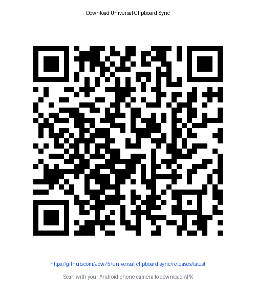

# Universal Clipboard Sync

> **Private, fast, and secure cross-device clipboard synchronization between Windows and Android.**

Universal Clipboard Sync bridges your Windows desktop and Android phone over your local Wi-Fi network. Copy text or screenshots on your PC and paste them instantly on your phone, or send copied text and images from Android back to your PC with zero friction.

[](https://github.com/Jow75/universal-clipboard-sync/releases/latest)
[](https://github.com/Jow75/universal-clipboard-sync/releases/latest)
[-3DDC84.svg)](https://github.com/Jow75/universal-clipboard-sync/releases/latest)
[](LICENSE)

---

## 📥 Downloads (v1.1.0)

| Package | Format | Size | Description | Download Link |
| :--- | :--- | :--- | :--- | :--- |
| **Windows Setup** | `.exe` (Installer) | ~44 MB | Recommended for Windows 10 & 11. Includes Start Menu & Desktop shortcuts | [Download Setup](https://github.com/Jow75/universal-clipboard-sync/releases/download/v1.1.0/UniversalClipboard-Setup-1.1.0.exe) |
| **Windows Portable** | `.exe` (Standalone) | ~47 MB | Single-file portable executable, runs without installation | [Download Portable](https://github.com/Jow75/universal-clipboard-sync/releases/download/v1.1.0/UniversalClipboard-Portable-1.1.0.exe) |
| **Android App** | `.apk` (v2 Signed) | ~5.7 MB | For Android phones & tablets (Android 8.0 to Android 15) | [Download APK](https://github.com/Jow75/universal-clipboard-sync/releases/download/v1.1.0/UniversalClipboard-Android-1.1.0.apk) |

### 📱 Scan to Download Android APK
Scan this official download QR code with your phone camera to download the latest release:



*Direct Link:* [https://github.com/Jow75/universal-clipboard-sync/releases/latest](https://github.com/Jow75/universal-clipboard-sync/releases/latest)

> **Local Network Download**: When the Windows application is running, you can also download the Android APK directly over your home Wi-Fi at `http://<YOUR_PC_IP>:8765/download` without needing internet access!

---

## 🔒 Verification & Checksums

Users can verify binary integrity using SHA-256 checksums:

```text
a5df099ffbc718841f2172f21d250d0ba6c8e3c9336e08cc484d75e5f809c5ae  UniversalClipboard-Setup-1.1.0.exe
be603914ae5341d291ac7ae2198e9840cd84b319346f86ecd00bdc7e7de547ce  UniversalClipboard-Portable-1.1.0.exe
758e660d16f6e52d912f95e31fa05e579660fb76e6b8cdecfd5979bbf21e7d3c  UniversalClipboard-Android-1.1.0.apk
```

---

## ✨ Features in Version 1.1.0

- **⚡ Seamless Bidirectional Clipboard Sharing**:
  - **PC ➔ Phone**: Copy on Windows (`Ctrl + C`) and immediately paste in any phone app.
  - **Phone ➔ PC (Zero-Tap)**: Optional Android Accessibility Service enables automatic copy sync without opening the app.
  - **1-Tap Quick Action**: Persistent notification button `[ 📋 Send to PC ]` and Quick Settings Tile for instant transfers.
- **🖥️ Smart Desktop Status Window**:
  - Displays pairing QR code while waiting for connection.
  - Seamlessly transitions to `🟢 CONNECTED TO ANDROID` upon pairing, showing connected device name and sync timestamps.
  - Dedicated "Download APK" tab with direct Wi-Fi download link and QR code.
- **🔄 Robust Reconnection Engine**:
  - Exponential backoff with jitter (2s–30s).
  - Monotonic connection epochs prevent stale socket callbacks from corrupting connection state.
  - Automatic UDP network discovery (`port 8766`) recovers seamlessly when router DHCP assigns a new IP address.
- **🔐 Hardware & OS-Backed Security**:
  - **AES-256-GCM Encryption**: All clipboard text and images encrypted with unique 96-bit IVs and 128-bit authentication tags.
  - **Windows DPAPI Storage**: Master keys protected by Windows DPAPI in `%APPDATA%\UniversalClipboard\config.json`.
  - **Android Keystore**: Master keys encrypted with hardware-backed Android Keystore.
  - **Replay Protection**: Mutual HMAC-SHA256 challenge-response handshake with 32-byte nonces.
  - **Echo-Loop Suppression**: Normalized line-ending SHA-256 hashing prevents infinite loop ping-pongs.

---

## 🚀 Quick Start Guide

### 1. Install on Windows
1. Download `UniversalClipboard-Setup-1.1.0.exe` and run the installer.
2. The application will launch into your **Windows System Tray** (near the clock).
3. Right-click the tray icon and select **🖥️ Open Status Window** (or double-click the tray icon).

### 2. Install on Android
1. Download `UniversalClipboard-Android-1.1.0.apk` from your phone browser or via local Wi-Fi at `http://<PC_IP>:8765/download`.
2. Tap the APK to install (allow "Install unknown apps" if prompted).
3. Open the app and grant Camera and Notification permissions.

### 3. Pair in Seconds
1. In the Windows status window, view the **Pair Device (QR Code)** tab.
2. On your phone, tap **Scan QR Code** and point your camera at the PC screen.
3. The Windows screen transitions immediately to **🟢 CONNECTED TO ANDROID**.
4. Both devices are permanently paired! You never need to scan again, even after rebooting.

---

## 📖 Detailed Documentation

- [Release Installation Guide](file:///docs/RELEASE_INSTALLATION_GUIDE.md) — Nontechnical step-by-step setup guide.
- [End-to-End Validation Guide](file:///docs/END_TO_END_TEST_GUIDE.md) — Test procedures, verification matrix, and unique test strings.
- [Known Limitations & Architecture Boundaries](file:///docs/KNOWN_LIMITATIONS.md) — Operating system restrictions and scope.
- [Release Verification Report](file:///docs/RELEASE_VERIFICATION_REPORT.md) — Exact file sizes, checksums, and signature verification.
- [Security Architecture & Threat Model](file:///docs/SECURITY.md) — Cryptographic protocol and security specifications.
- [Privacy Policy & Data Handling](file:///docs/PRIVACY.md) — Zero-telemetry, local LAN only, zero persistent clipboard history.

---

## 🧪 Developer Build & Test Instructions

### Running Python Tests
```bash
python -m pytest -v
# 18 passed in 6.42s
```

### Running Android Unit Tests
```bash
cd android
.\gradlew.bat testDebugUnitTest
# 7 passed in 13s
```

### Building Windows Binaries
```bash
# Standalone PyInstaller Executable
python -m PyInstaller build_exe.spec --clean --noconfirm

# Inno Setup Installer
& "C:\Program Files (x86)\Inno Setup 6\ISCC.exe" "installer\UniversalClipboard.iss"
```

### Building Android Release APK
```bash
cd android
.\gradlew.bat assembleRelease
```

---

## 📄 License
Universal Clipboard Sync is open-source software licensed under the **MIT License**.
