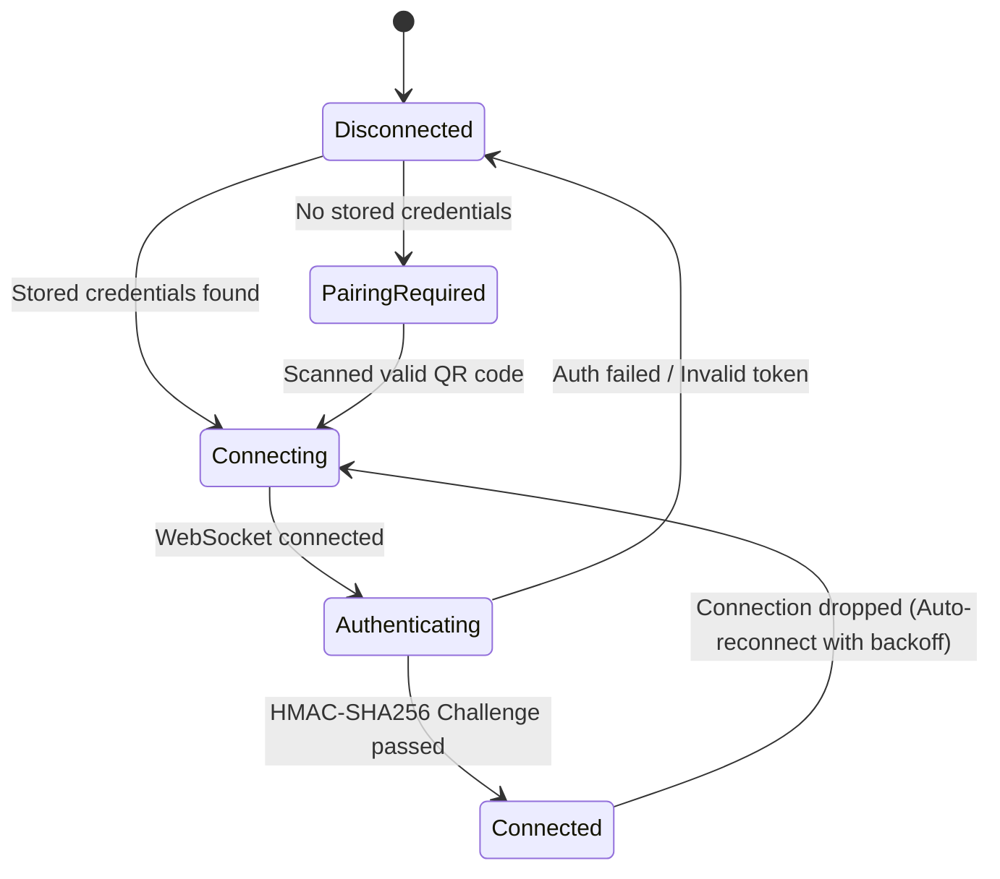

# Network Architecture & Cross-Network Design

## 1. Overview

Universal Clipboard Sync is designed for fast, private, and local-first cross-device clipboard synchronization between Windows and Android devices. It operates without cloud account dependencies, routing, or mandatory central servers.

```
+-------------------------------------------------------------------+
|                        Local Wi-Fi Network                        |
|                                                                   |
|   +--------------------+                 +--------------------+   |
|   |   Windows Desktop  |                 |   Android Client   |   |
|   |  - WS Server: 8765 | <== WS (AES) == |  - WS Client       |   |
|   |  - UDP Bcn:   8766 | === UDP Bcn ==> |  - UDP Listener    |   |
|   +--------------------+                 +--------------------+   |
+-------------------------------------------------------------------+
```

---

## 2. Local-Network (Same-LAN) Operation

### 2.1 Interface Filtering & Binding
Previously, the desktop application would bind to or advertise arbitrary network interfaces, frequently selecting virtual adapters (WSL, Hyper-V, VirtualBox, VMware) or VPN tunnels. This made the desktop unreachable to the phone.

The enhanced network subsystem (`desktop/network_discovery.py`) applies intelligent adapter selection:
1. **Enumeration**: Scans all active IPv4 interfaces using `socket.getaddrinfo` and local routing probes.
2. **Exclusion Filter**: Excludes loopback (`127.x.x.x`), link-local (`169.254.x.x`), and known virtual adapter IP ranges (e.g. `172.17.x.x`–`172.31.x.x` for Docker/WSL, `192.168.56.x` for VirtualBox).
3. **Local Route Verification**: Probes the default gateway using UDP socket routing (`8.8.8.8:80` without sending packets) to identify the primary outbound LAN interface.
4. **WebSocket Binding**: Binds to `0.0.0.0:8765` so all valid LAN interfaces accept connections, while advertising the filtered primary local IP in the QR code and UDP beacons.

### 2.2 UDP Discovery Beacon (Port 8766)
To support dynamic DHCP IP changes without requiring re-pairing:
- The desktop broadcasts a periodic lightweight UDP beacon on port `8766` every 5 seconds.
- **Payload Format**: `UCS_BEACON:v=2;id=<device_id>;port=8765`
- The Android client listens for broadcast beacons on port `8766` when reconnecting.
- If the desktop's IP changes (e.g., router DHCP lease renewal), Android identifies the beacon matching its stored `device_id`, updates its endpoint, and automatically reconnects without user intervention.

---

## 3. Connection State Machine

Both platforms follow a rigorous 5-state lifecycle:



1. **Disconnected**: No active socket connection.
2. **Pairing-Required**: First launch or explicitly unlinked; requires scanning a QR code.
3. **Connecting**: Socket connection in progress; retrying with exponential backoff (`min(1 * 1.5^attempt, 30s) + jitter`).
4. **Authenticating**: WebSocket frame level handshake. Server sends 32-byte cryptographically secure random nonce (`auth_challenge`). Client responds with HMAC-SHA256 signature using the shared master key.
5. **Connected**: Bidirectional AES-256-GCM encrypted synchronization active.

---

## 4. Cross-Network Connectivity Architecture (Future Relay Design)

Users frequently transition from home Wi-Fi to cellular networks (e.g., 5G/LTE) while leaving their desktop at home or the office. Local UDP/WS cannot traverse Carrier-Grade NAT (CGNAT) or home firewalls without specialized traversal.

### 4.1 Architecture Options Evaluated

| Strategy | Security | Infrastructure Cost | Latency & Throughput | Feasibility |
| :--- | :--- | :--- | :--- | :--- |
| **1. Direct P2P via STUN/TURN (WebRTC DataChannel)** | End-to-end encrypted; direct P2P when NAT permits | Low STUN cost; TURN bandwidth costs on symmetric NAT | Ultra-low latency P2P; degraded when relayed | Complex native WebRTC stack integration on Python and Android |
| **2. Zero-Knowledge Cloud Relay (Encrypted WebSocket)** | End-to-end encrypted; Relay sees only ciphertexts | Moderate bandwidth hosting (e.g., Cloudflare Workers / Fly.io / VPS) | Single intermediate hop (~30–80ms); very consistent | Highly reliable; compatible with existing protocol |
| **3. Self-Hosted Relay (Docker/VPS)** | Maximum privacy; complete user control | Zero product cost (user provides infrastructure) | Dependent on user host location | Excellent for advanced users |

### 4.2 Recommended Approach: Zero-Knowledge E2EE Relay
For cross-network synchronization, the recommended production architecture is a **Zero-Knowledge Encrypted WebSocket Relay**:

1. **End-to-End Encryption Maintained**: The master key established during local QR pairing remains exclusively on the desktop and phone. The relay server never possesses the master key and only transports authenticated AES-256-GCM ciphertexts.
2. **Relay Authentication**: Devices authenticate to the relay room using an ephemeral HMAC signature derived from the pairing identity: `room_id = SHA256("UCS_ROOM:" + device_id)`.
3. **Fallback Order**:
   - First attempt: Direct LAN WebSocket connection (`ws://<local_ip>:8765`).
   - Second attempt: UDP discovery probe on LAN.
   - Fallback attempt: If LAN unreachable and user enables "Remote Sync", connect to `wss://relay.universalclipboard.net/v2/<room_id>`.
4. **Bandwidth Optimization**: Large images (>2MB) can optionally be deferred or scaled over cellular connections to conserve data.
